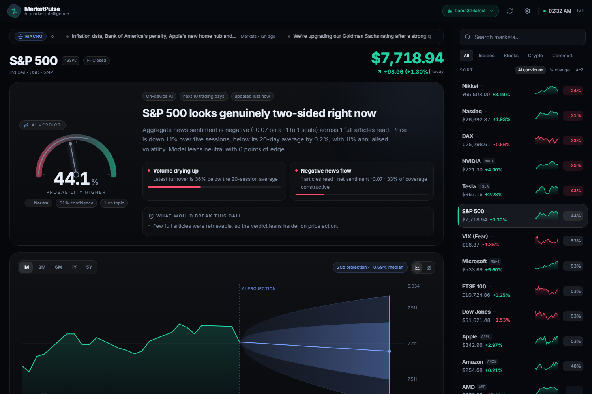

# MarketPulse

An AI market-intelligence terminal. It pulls **live** prices and news, actually **reads the
articles**, and turns them into a **probability** of where a market goes next — plus a forecast
cone showing how wide the range of outcomes is.

**It runs entirely on the device. There is no server, no backend, no database, no API key.**
Same code, three platforms: Windows, Android, iPhone.



---

## Install it

### Windows — a real .exe

```bash
npm run build:exe
```

Produces two files in `release/` (already built and sitting there now):

| File | What it is |
| --- | --- |
| `MarketPulse-2.0.0-x64.exe` | Installer — Start menu + desktop shortcut |
| `MarketPulse-2.0.0-portable.exe` | Single file, runs anywhere, no install |

Double-click and it opens in its own window. No browser, no URL, no Node, no server.

> If packaging fails with `EPERM ... rename 'win-unpacked.tmp'`, a virus scanner has locked the
> freshly extracted files. Build to a different folder instead:
> `npx electron-builder --win --config.directories.output=%TEMP%\mp-release`

### Android — a real, signed .apk

**`Desktop\MarketPulse.apk`** (7.1 MB) is already built, verified, and install-tested on a
Pixel 10. Copy it to your phone and tap it, or install over USB with `adb install`.

It is a proper Android app: its own icon on the launcher, no browser, no server, and it works
offline. The web build is bundled in and served from a virtual HTTPS origin
(`https://marketpulse.local`), which gives it a real secure origin — so storage persists, fetch
behaves with normal CORS, and market data still comes live from the internet.

To rebuild:

```bash
npm run build            # the web build that gets bundled
powershell -ExecutionPolicy Bypass -File android/build-apk.ps1
node android/validate-apk.mjs
```

Requires the Android SDK build-tools and a JDK 17. By default the script looks for them under
`C:\apktool`; point it somewhere else with `-SdkRoot` or the `ANDROID_SDK` env var. The build uses
`aapt2` / `javac` / `d8` / `zipalign` / `apksigner` directly — **no Gradle, no Android Studio**.

- Package `com.marketpulse.app`, minSdk 26 (Android 8.0+), targetSdk 34 (Android 14)
- Signed with a v2 + v3 signature scheme
- Includes the on-device AI runtime, so the transformer works offline inside the app

#### Three packaging traps worth knowing

Each of these produces a file that looks like a perfectly valid APK and fails only on a real
device, so `android/validate-apk.mjs` now checks all of them.

1. **`resources.arsc` and `AndroidManifest.xml` must be stored uncompressed.** Android 11+ refuses
   to install any app targeting API 30+ otherwise, and reports only
   `Failed parse during installPackageLI: ... -124`. That reads like a corrupt download; it has
   nothing to do with one, which is why a phone-based install can "fail" on a byte-perfect file.

2. **Asset paths must use forward slashes.** aapt2 writes them with the host separator on Windows
   (`assets\index.js`), and Android's asset manager only resolves `/`. The symptom is a blank
   screen: every script 404s, and the app looks like it launched fine.

3. **Don't repack the APK with .NET.** `CompressionLevel.NoCompression` is silently ignored on
   .NET Framework (Windows PowerShell 5.1) and still emits a deflated entry, so attempt 1 at
   fixing trap 1 did nothing. `android/tools/Pack.java` sets `ZipEntry.setMethod(STORED)`
   explicitly instead.

Keep `android/marketpulse.keystore`. It has to live outside the build's output folder, because
generating a fresh key per build makes every rebuild a *different app* to Android — upgrades then
fail with `INSTALL_FAILED_UPDATE_INCOMPATIBLE` unless you uninstall first.

The file is **gitignored**, and that is deliberate: this keystore is the app's signing identity, so
anyone holding it could sign an update that Android installs straight over yours. Back it up
somewhere private rather than committing it.

### iPhone

iOS has no sideloading outside the App Store, and an App Store build needs a Mac plus a paid
Apple Developer account. The installable web app is the practical route: open the link in
Safari, tap Share, then **Add to Home Screen**. It launches fullscreen with its own icon and
keeps working offline.

```bash
npm run build      # the folder to upload
```

### Development

```bash
npm install
npm run dev        # http://localhost:5173
```

One process, one port, no backend. `npm start` opens the desktop app against the same build.

---

## How it works with no server

Browser apps can't call most market APIs directly — they don't send CORS headers. The app
solves that in the browser rather than with a server of its own:

| Need | How it's reached | CORS? |
| --- | --- | --- |
| Quotes, candles, ticker news | via the **r.jina.ai** relay | relay allows it |
| All 22 sidebar markets | **one batched request** (not 22) | relay allows it |
| News wire (CNBC, MarketWatch, NYT) | **fetched directly** | yes |
| Crypto | **CoinGecko**, fetched directly | yes |
| AI (optional) | **Ollama on this device** | yes |
| AI (optional) | **transformer in the browser** | n/a — it's local |

A small scheduler paces every relayed request (3 concurrent, 320 ms apart) and **honours the
`retryAfter` the relay returns** when it throttles, backing the whole queue off rather than
hammering it. In-flight requests are de-duplicated, and results are cached so a second visit
costs nothing.

---

## Making sure the news is actually about the market

This turned out to be the hardest part of the whole thing, and getting it wrong is worse than
having no news at all — a confident verdict built from an unrelated company's article is
actively misleading.

**Every story is scored for relevance to the market you're looking at:**

| Score | Meaning | Used as AI evidence? |
| --- | --- | --- |
| 100% | Provider tags the story with *your* ticker **and** the name is in the headline | yes |
| 80% | Provider tags the story with your ticker | yes |
| 75% | The company or index name is in the headline | yes |
| 60% | Index-level ticker tag (broader by nature) | no |
| 50% | Name mentioned in the body | no |
| 30% | Sector or general market context | no |

Only 75% and above can influence the verdict. If fewer than two such stories exist, the LLM is
**not consulted at all** and the app falls back to a technicals-led call rather than pretending.

**Junk never reaches the feed.** A blocklist drops personal-finance advice columns ("Ask a
Personal Finance Advisor", "My sister moved in with…"), local politics, lifestyle pieces, and
investment listicles from Motley Fool, Simply Wall St and friends. The reader also rejects
cookie walls and consent pages — if an article can't actually be read, the app says "headline
only" instead of lying about having read it.

The search itself is done on the **bare ticker** (`NVDA`, not "NVIDIA stock"), which is the
difference between real NVDA news and investment spam.

---

## The AI — three tiers, all on-device

The app uses the best tier the device can actually run, and says which one it used.

### 1. Ollama — the full written verdict

If Ollama is running, the model reads the full text of each article and writes the headline,
summary, drivers and risks itself. ~10 s on a warm model.

Detected automatically at `127.0.0.1:11434`. On a phone you can point it at your PC over Wi-Fi
(Settings -> Ollama endpoint).

### 2. On-device transformer — what makes the phone standalone

A real transformer (DistilBERT by default) runs **inside the browser** via WebAssembly and
scores every article's sentiment. ~66 MB, downloaded once, then cached by the service worker —
after that it works with no connection at all.

Validated at 7/7 correct on financial headlines, ~10 ms per headline after load. Its score is
**blended with the finance lexicon** (0.6 / 0.4): the model reads tone, the lexicon knows that
*"guidance cut"* and *"raises guidance"* are not the same thing.

Three models are selectable in Settings; all run on plain WASM, which is predictable on phones.

### 3. Built-in engine — always on, zero download

A weighted financial lexicon with negation handling (*"fails to beat"* flips the sign), recency
decay and relevance weighting, combined with RSI, momentum, moving averages and realised
volatility. Instant, offline, no dependencies.

### How the final number is produced

```
0.62 x (LLM probability, if available)  +  0.38 x (deterministic model)
```

The LLM writes the narrative; the deterministic model **anchors the number**, so a chatty model
can't talk the technicals out of the result. Confidence is penalised when the two disagree.

---

## Features

- **Probability dial** — animated gauge with a confidence arc
- **Forecast cone** — median path with 50%/80% bands, 20 sessions out, end-of-horizon target
- **Line / candlestick** toggle, 1M to 5Y, live crosshair and tooltip
- **AI news feed** — every article scored, expandable to show what tipped the model
- **Sidebar of 22 markets** — indices, stocks, crypto, commodities; search, filters, sort by
  AI conviction / % change / A-Z
- **Background conviction sweep** — every market gets its own probability as it completes
- **Macro briefing ticker** — cross-market headlines, click to jump
- **Offline-first** — app shell, icons and the AI model are all cached
- Motion throughout: layout-animated sorting, blur+fade between markets, count-up numbers,
  skeleton shimmer, chart wipe, cone reveal
- Phone: splash screen, tab bar, collapsing large title, spring transitions, haptics

---

## Project layout

```
electron/main.mjs         Desktop shell — loads the built app from disk
src/app/
  analyze.ts              Orchestrator: 3 tiers -> one probability
  stats.ts                RSI, moving averages, momentum, realised volatility
  lexicon.ts              Financial sentiment lexicon + fallback verdict
  forecast.ts             Probability-cone maths
  markets.ts              The 22 markets and their aliases
  ai/ollama.ts            Ollama discovery, queued requests, JSON repair
  ai/ondevice.ts          In-browser transformer
src/lib/
  net.ts                  Relay routing, pacing, backoff, cache
  api.ts                  The app's data layer (what a server used to provide)
  data/                   Quotes (batched) | news | RSS parsing + relevance
src/mobile/               iOS-style shell: tab bar, nav bar, grouped lists, launcher
public/
  manifest.webmanifest    PWA install metadata
  sw.js                   Offline cache
scripts/
  verify.mjs              Automated browser checks (16)
  verify-desktop.mjs      Launches the packaged app and checks it
  check-correlation.mjs   Proves the news is about the right market
  test-ondevice.mjs       Validates the sentiment model
server/                   Optional legacy Node server (no longer required)
```

## Verification

```bash
npm run verify            # 16 checks in a real browser
npm run verify:desktop    # launches the packaged .exe
npm run test:model        # checks the on-device sentiment model
```

The web suite asserts that market data loads **with no backend running**, that the sidebar,
chart, verdict, news and PWA manifest all render, that the phone shell has its tab bar and
navigation, and that there are no script errors.

## Notes & limits

- Prices and news come from public endpoints. They are delayed, occasionally throttled, and
  everything is cached client-side (quotes 45 s, news 5 min, analysis 10 min).
- On first load the on-device model downloads (~66 MB). Until then the built-in engine is used.
- Probabilities are a statistical model's output for research and education. **Not financial
  advice.**

---

## Credits

Built and designed by **Marko Tomic**.

- Quotes, candles and ticker news — Yahoo Finance, reached through the r.jina.ai relay
- News wire — CNBC, MarketWatch and The New York Times feeds
- Crypto — CoinGecko
- Sentiment model — DistilBERT (`Xenova/distilbert-base-uncased-finetuned-sst-2-english`), running
  on-device via `@huggingface/transformers`

MarketPulse is not affiliated with or endorsed by any of the above. All market data and news
belong to their respective owners and are used here for research and education.

## License

[MIT](LICENSE) © Marko Tomic
